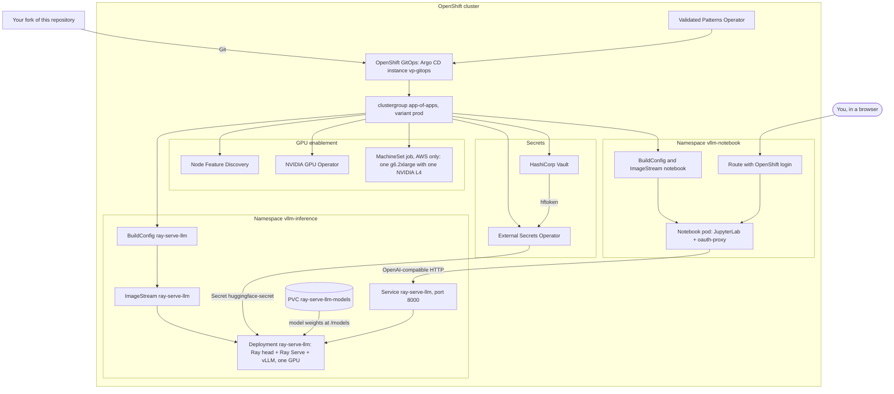

# vLLM + Ray Serve inference server: a community GitOps pattern by Eugo

This [Validated Pattern](https://validatedpatterns.io/) deploys an OpenAI-compatible LLM server on Red Hat®
OpenShift® through Red Hat OpenShift GitOps. The server is a single pod that runs Ray Serve LLM with the vLLM engine. The cluster builds
its image from this repository, using stock packages only: PyPI wheels on NVIDIA's CUDA UBI 9 image. The pattern
also deploys the pieces the server needs: Node Feature Discovery and the NVIDIA GPU Operator, and Vault with External
Secrets for an optional Hugging Face token. It adds a small JupyterLab whose notebook times the server.

**Community sandbox pattern by Eugo — not produced, supported or validated by Red Hat.**

Eugo, which maintains this pattern, runs an HPC platform that rebuilds open-source native and Python packages,
PyTorch and vLLM among them, from source. This pattern does not use it: it installs stock packages only. More at
[eugo.io](https://eugo.io/).

**The problem it solves.** This pattern does not replace Red Hat's AI products, such as Red Hat OpenShift AI, and it
does not plug into them. It is a small, community-maintained reference point: stock vLLM on Ray Serve, built from
known versions and measured the same way each time, so you can see what the upstream stack does on your GPU. It needs
no OpenShift AI subscription.

- **One repository.** Your fork describes the GPU enablement (Node Feature Discovery and the NVIDIA GPU Operator),
  the server, its model cache, Vault and External Secrets for an optional Hugging Face token, and a timing notebook.
  You run `./pattern.sh make install` once. After that, Argo CD syncs each commit on your branch, with two limits:
  it does not delete objects that a commit removes, and it does not change the image of the running server or
  notebook. Images come from builds in the cluster. A rebuild job checks your branch every 10 minutes. It starts a
  build when the server's or the notebook's folder changed and no build of that image is already running. It does
  not retry a failed build.
- **Pinned where it can be.** Every Python package is locked by hash and installed from wheels only. The server has
  one lock per CPU architecture; the notebook has one lock for both. The server's and the notebook's base images are
  pinned by digest, and the default model by its Hugging Face commit. Some things are not pinned, among them the system packages that `dnf`
  adds to the server image, the operator versions (the pattern's own operator subscriptions follow stable channels and update automatically) and the patch versions
  of the Validated Patterns charts. So two builds from one commit install the same Python packages, but their
  system packages can differ.
- **Measured.** The notebook times the server in your cluster: pod start to Ready, time to first token,
  single-stream decode speed, and total tokens per second at 1, 8 and 32 concurrent requests. The prompts are
  chosen from a fixed seed, and every request uses temperature 0 and a fixed number of output tokens. Results are in
  seconds and tokens per second. Start to Ready is in whole seconds and can trail the server by up to about 2
  seconds.
- **Separate from OpenShift AI.** The server is one pod in a plain Deployment, running Ray Serve LLM with the vLLM
  engine from PyPI (Ray 2.60.0, vLLM 0.29.0, PyTorch 2.13.0) on NVIDIA's CUDA 13.0.3 UBI 9 image. It uses no
  KServe, no KubeRay and no Red Hat AI Inference Server image: the chart has no KServe `InferenceService` or
  `ServingRuntime`.
- **Its own cluster, for now.** The pattern installs Node Feature Discovery and the NVIDIA GPU Operator itself,
  with its own OperatorGroups and settings. On a cluster that already runs those operators it can clash with them,
  and it has not been tried on a cluster that runs OpenShift AI. Use a cluster without those two operators.

> [!WARNING]
> **Cost.** On AWS, the default install creates **one billable GPU instance: `g6.2xlarge` with one NVIDIA L4**.
> AWS bills it for as long as it runs.
>
> - To stop that, set `global.gpuMachineSet: none` in `values-global.yaml` in your fork, and push the change,
>   before you install.
> - Off AWS, nothing is created.
> - Uninstalling does not delete the GPU machine; see [Uninstall](#uninstall).

- [Architecture](#architecture)
- [What is in the stock stack](#what-is-in-the-stock-stack)
- [Prerequisites](#prerequisites)
- [Quick start](#quick-start)
- [What to expect on the first install](#what-to-expect-on-the-first-install)
- [Using the API](#using-the-api)
- [The notebook](#the-notebook)
- [Compare two images](#compare-two-images)
- [Scale out](#scale-out)
- [Changing the model](#changing-the-model)
- [Uninstall](#uninstall)
- [Support](#support)
- [License](#license)
- [Trademarks](#trademarks)
- [What this pattern was verified against](#what-this-pattern-was-verified-against)

Contributors and coding agents: read [AGENTS.md](AGENTS.md). It covers the repo layout, every deploy path, the rules
and troubleshooting.

## Architecture



- **The Validated Patterns Operator** installs OpenShift GitOps. It points Argo CD at your fork through the
  clustergroup chart, which creates every app listed in `variants/prod/values-prod.yaml`.
- **The server pod** runs a Ray head, Ray Serve and vLLM. It reports Ready only after the model has loaded.
- **The notebook pod** serves JupyterLab behind the OpenShift oauth-proxy. Only users who may edit the
  `vllm-notebook` namespace (its editors and admins, and cluster admins) can open it. It talks to the server
  through the in-cluster Service.
- **The image comparison**, off by default, adds a Job in `vllm-notebook` that takes the server down and measures
  two server images in turn on its GPU ([Compare two images](#compare-two-images)).
- **Scale out**, off by default, adds vLLM replicas inside the server pod (Ray Serve's autoscaler), whole server
  pods (Red Hat's Custom Metrics Autoscaler), or both ([Scale out](#scale-out)).

## What is in the stock stack

| Component | Version | Source |
|---|---|---|
| Ray (`ray[llm]`, Ray Serve LLM) | 2.60.0 | PyPI |
| vLLM | 0.29.0 (the version Ray 2.60.0 pins) | PyPI |
| PyTorch | 2.13.0, CUDA 13.0 wheels | PyPI |
| FlashInfer | 0.6.18 | PyPI |
| CUDA toolkit (`nvcc`, runtime) | 13.0.3 | the base image, plus the pip `cuda-toolkit` 13.0.3 pin |
| Python | 3.12 | UBI 9 packages |
| Base image | `nvcr.io/nvidia/cuda:13.0.3-devel-ubi9`, pinned by digest | NVIDIA, no login needed |
| Default model | `Qwen/Qwen2.5-0.5B-Instruct` at a pinned revision, served as `qwen2.5-0.5b-instruct` | Hugging Face, not gated |

- **Locks.** Python packages are installed from hash-locked files, one per CPU architecture
  (`inference-server/requirements-x86_64.lock` and `requirements-aarch64.lock`), with wheels only. A third lock,
  `requirements-pip.lock`, pins the pip that installs them.
- **Everything comes from PyPI.** No package index outside PyPI is used, so FlashInfer compiles its GPU kernels on
  the node when the server starts. The image does not include the patches Ray applies in its own `rayproject/ray-llm`
  images.
- **Telemetry is off.** Ray and vLLM usage statistics and request prompt logging are turned off.
- **Operators:**
  - Red Hat OpenShift GitOps;
  - the Validated Patterns Operator (community);
  - the Red Hat External Secrets Operator;
  - Node Feature Discovery;
  - the NVIDIA GPU Operator (certified).

  HashiCorp Vault comes from the Validated Patterns chart.

The notebook labels the server it times "Stock vLLM 0.29.0 · Ray 2.60.0 · PyTorch 2.13.0 from PyPI · Python 3.12 ·
NVIDIA CUDA 13.0.3 UBI 9 image".

GPU support: built for the GPU architectures in vLLM's release build list
([v0.29.0 release pipeline](https://github.com/vllm-project/vllm/blob/v0.29.0/.buildkite/release-pipeline.yaml));
on OpenShift we have tested only the NVIDIA L4 (see
[What this pattern was verified against](#what-this-pattern-was-verified-against)). CUDA 13 needs NVIDIA driver
version 580 or newer.

## Prerequisites

- OpenShift 4.18 or newer, and cluster-admin access.
- A cluster that does not already run Node Feature Discovery or the NVIDIA GPU Operator. The pattern installs both
  itself, with its own OperatorGroups and settings, and can clash with existing installs of them. It has not been
  tried on a cluster that runs OpenShift AI.
- A StorageClass that provisions volumes dynamically, for the model cache.
- The internal image registry set to `Managed`: the cluster builds both images itself. It starts as `Removed` on
  bare metal and vSphere. To check:
  `oc get configs.imageregistry.operator.openshift.io cluster -o jsonpath='{.spec.managementState}'`
- A GPU node. On AWS the pattern creates one (see the cost note above), except on clusters installed into existing
  subnets, where the job cannot copy the subnet: set `gpuMachineSet: none` there and add the GPU node yourself.
  Elsewhere, add a node with an NVIDIA GPU that the NVIDIA GPU Operator supports.
- On your workstation:
  - podman 4.3 or newer;
  - git;
  - `oc`, logged in to the cluster;
  - if `KUBECONFIG` is set, it must point inside your home directory.
- Your own fork of this repository, with your branch pushed. Argo CD deploys from that fork, not from your disk.

## Quick start

1. Fork this repository on GitHub, then clone your fork:
   ```sh
   git clone https://github.com/<you>/vllm-ray-inference-server.git
   cd vllm-ray-inference-server
   ```
2. Edit `values-global.yaml`:
   - `global.gpuMachineSet`: `create` (one AWS g6.2xlarge) or `none`.
   - `global.model.*`: optional.

   Commit and push:
   ```sh
   git commit -am "Configure my install"
   git push
   ```
3. Optional, needed only for a gated model: create your secrets file and put your Hugging Face token in `hftoken`.
   Keep this file out of git.
   ```sh
   mkdir -p ~/.config/validated-patterns
   cp values-secret.yaml.template \
      ~/.config/validated-patterns/values-secret-vllm-ray-inference-server.yaml
   ```
4. Log in and install:
   ```sh
   oc login --token=<token> --server=<api-url>
   ./pattern.sh make install
   ```
5. Watch it come up:
   ```sh
   oc get applications.argoproj.io -A
   oc get builds -n vllm-inference
   oc get pods -n vllm-inference -w
   ```

[AGENTS.md](AGENTS.md#how-to-deploy) also covers the web-console install, private forks, reloading secrets, and how
updates and image rebuilds work.

**Installed under the old name?** This pattern was named `rhvp-vllm-ray-inference-server` until November 2026,
and its namespaces were `rhvp-inference` and `rhvp-notebook`; they are now `vllm-inference` and `vllm-notebook`. An
install made under the old name keeps working. Merging the rename into its branch does not delete the old
namespaces: Argo CD builds and starts a second server and notebook in the new ones, and the old server keeps its
GPU, so with one GPU the new server waits until you delete the old namespaces. To move the install to the new name,
uninstall it first and merge the rename after:

1. Download any notebook work you want to keep.
2. Uninstall it with `PATTERN_NAME=rhvp-vllm-ray-inference-server ./pattern.sh make uninstall`.
3. Once the uninstall has finished, merge the rename into your branch, if you have not already, and push it. The
   uninstall has finished when the Pattern resource is gone and the operator has removed the apps:
   `oc get patterns -A` no longer lists `rhvp-vllm-ray-inference-server`, and `oc get applications.argoproj.io -A`
   lists none of its apps. The install in step 6 takes the pattern name from your clone and deploys from your fork,
   so it needs the rename in both. Merging only after the uninstall keeps the old install from syncing the rename
   and starting a second server. This order follows from the charts and the installer; it has not been tried on a
   cluster.
4. Check for the old namespaces and the old model's claim. Delete what is left; this deletes the downloaded model.
   ```sh
   oc get namespace rhvp-inference rhvp-notebook
   oc get pvc -n rhvp-inference
   oc delete namespace rhvp-inference rhvp-notebook
   ```
   Then check `oc get pv` for a volume whose claim was `rhvp-inference/ray-serve-llm-models`. A volume with the
   reclaim policy `Retain` stays after its claim is deleted; delete it with `oc delete pv <name>`. That deletes only
   the Kubernetes object: the backing disk (an EBS volume on AWS) stays until you delete it in your storage backend.
5. Rename your secrets file from `values-secret-rhvp-vllm-ray-inference-server.yaml` to
   `values-secret-vllm-ray-inference-server.yaml`.
6. Install again with `./pattern.sh make install`. The new install builds both images and downloads the model again.

Until you move it, set `PATTERN_NAME=rhvp-vllm-ray-inference-server` on every `make` target you run on it.
Without it, `load-secrets` can load the repo's template instead of your file and replace your token in Vault with
`none`, and `install` creates a second Pattern next to the old one. [AGENTS.md](AGENTS.md#updating-a-running-install)
has the details, including what to delete after a merge and the one target that ignores `PATTERN_NAME`.

## What to expect on the first install

The first install does a lot of work, in roughly this order:

1. The operators install, and Vault starts.
2. On AWS, the MachineSet job creates the GPU node. The GPU Operator then installs the NVIDIA driver on it.
3. The cluster builds the server image from `inference-server/Containerfile`. This is a large build: it pulls a
   multi-gigabyte CUDA development image and installs several gigabytes of wheels, so the build node needs plenty of
   free ephemeral storage. On an m5.2xlarge node it took 17 to 18 minutes.
4. The server pod stays Pending until a node advertises `nvidia.com/gpu`.
5. On its first start, the server downloads the model into the PVC `ray-serve-llm-models`, where it stays across
   restarts. vLLM and FlashInfer also compile GPU kernels. Those caches are not kept, so every new server pod compiles
   them again.
6. The pod turns Ready only once the model is loaded.

`./pattern.sh make install` waits at most 60 minutes for every Argo CD application to be Synced and Healthy, and
reports a failure if they are not. On a new AWS cluster it finished in 30 minutes, but a first install elsewhere
can outlast that wait. The failure undoes nothing: the pattern is already installed and its secrets loaded. To
recover:

```sh
oc get builds -n vllm-inference                  # is the image build still running, or did it fail?
oc logs -f bc/ray-serve-llm -n vllm-inference    # follow the latest build
oc start-build ray-serve-llm -n vllm-inference --follow   # only if the build failed
oc get pods -n vllm-inference                    # Pending = no GPU yet; Running but not Ready = still loading
./pattern.sh make argo-healthcheck               # re-check once things settle
```

To skip the wait entirely, install with `VP_SKIP_ARGO_HEALTHCHECK=true ./pattern.sh make install`, then run
`./pattern.sh make argo-healthcheck` later.

## Using the API

The server is reachable inside the cluster at `http://ray-serve-llm.vllm-inference.svc:8000`. From your workstation,
forward the port:

```sh
oc port-forward svc/ray-serve-llm 8000:8000 -n vllm-inference
```

In another terminal:

```sh
curl -s http://localhost:8000/v1/models

curl -s http://localhost:8000/v1/chat/completions \
  -H 'Content-Type: application/json' \
  -d '{
        "model": "qwen2.5-0.5b-instruct",
        "messages": [{"role": "user", "content": "Say hello in one sentence."}],
        "max_tokens": 64
      }'
```

The `model` field is `global.model.id`. Any OpenAI-compatible client works with `base_url` set to
`http://localhost:8000/v1`.

**Optional Route.** Set `route.enabled: true` in `charts/all/ray-serve-llm/values.yaml` in your fork and push. The
Route raises the router timeout to 10 minutes. It has no authentication: anyone who can reach the cluster's router
can use the model and the GPU.

## The notebook

Open it through its Route and log in with your OpenShift account. The proxy lets in only users who may update the
Service `notebook` in namespace `vllm-notebook`: that namespace's editors and admins, and cluster admins. Any
other logged-in user gets 403 Forbidden. To let someone in, give them the `edit` role there:
`oc adm policy add-role-to-user edit <user> -n vllm-notebook`.

```sh
oc get route -n vllm-notebook
```

The notebook is `inference_timings.ipynb`. It times the server in four sections:

1. **Server pod start to Ready.** Read from the pod's Kubernetes status, so this section runs only inside the
   cluster. Kubernetes records these times in whole seconds, and the server's probes check for its ready file
   every 2 seconds, so Ready can be recorded up to about 2 seconds after the server is serving.
2. **Time to first token.**
3. **Single-stream decode tokens per second.**
4. **Aggregate tokens per second at 1, 8 and 32 concurrent requests.**

How it measures:

- The prompts are distinct, generated from a fixed seed, and each has the same number of words (so about the same
  number of tokens).
- In sections 2 to 4, a warm-up with different prompts runs before the timed requests.
- Every request uses `temperature=0` and a fixed `max_tokens`.
- Tokens are counted from the server's usage report.

Every section measures this stock server live, in your run, and shows its result in seconds or tokens per second.

The pod copies the notebook folder into a scratch directory each time it starts, so your edits are lost when the
pod restarts. Download anything you want to keep. The notebook is generated by `notebooks/make_notebook.py` and is
committed without outputs.

## Compare two images

The pattern can compare two inference-server images on your cluster: the same model, the same GPU and the same
requests, measured in rounds that take turns between the two. It is off by default. The example in
`values-global.yaml` compares two upstream vLLM releases, `vllm/vllm-openai` v0.32.0 (side A, the baseline) and
v0.33.0 (side B), both pinned by digest. Every ratio it reports is B/A.

### Plan it as a maintenance window

A run takes the pattern's own server down for its whole length. The comparison needs the server's GPU and its model
volume, so the runner scales Deployment `ray-serve-llm` to 0 before the first round and back to 1 when the run ends,
whether it finished, failed or was stopped. When it is stopped, it asks the server back first, before it takes the
round's side down; the server's pod then waits for the GPU. It tries the scale for about a minute and reads it back
to check. With the default settings a run is 22 rounds; we estimate 2 to 3 hours on one GPU, but we have not timed
it on a cluster.

The `ray-serve-llm` app ignores the Deployment's `replicas` on every install, also when the comparison is off: a sync
never changes the server's replica count. That keeps a sync during a run from bringing the server back early, and
it also means a server at 0 replicas stays at 0 until someone scales it.

If the server did not come back, the run says so: its Job exits 4, `run.server_restored` is `false` in the results,
the status ConfigMap and the termination message, and the log's last lines give the commands below. If the runner's
pod was killed outright (its node is lost, or it is force-deleted), nothing says so; check the server. Either way,
delete any side pod left behind first (it holds the GPU and the model volume until its own time limit, up to about
an hour and a half), then scale the server back:

```sh
oc delete pod -n vllm-inference -l app.kubernetes.io/name=image-compare-side
oc scale deployment/ray-serve-llm --replicas=1 -n vllm-inference
```

### Run a comparison

1. Wait until the first install has finished and the notebook image has been built: the runner takes its code from
   that image. With `image.override` on the notebook chart, your image must contain `notebooks/rhvp_compare`.
2. In `values-global.yaml`, under `global.compare`:
   - set `enabled: true`;
   - set the two `sides`: a `name`, an `image` (pin it by digest), and a `preset`: `vllm-openai` for an upstream
     vLLM OpenAI server image, `ray-serve-llm` for this pattern's own server image, or `custom` with your own
     `command` and `args`;
   - check `runName`, `rounds`, `load` and `analysis`. The comments there explain each setting.
3. Commit and push. Argo CD creates the Job `compare-<runName>-<hash>` in `vllm-notebook`. We expect the `notebook`
   app to show Progressing while the Job runs; this has not been tried on a cluster.
4. Follow it: `oc get configmap -n vllm-notebook -l app.kubernetes.io/component=compare-run`, or the Job's log.
5. Open `compare_images.ipynb` in the notebook to see the results.

To run again, change `runName` or any other value under `global.compare`. A changed config is a new run. A run whose
results are complete is never run again.

One comparison runs at a time. A runner that finds an older runner pod still Pending or Running in `vllm-notebook`
refuses to start: it changes nothing (no results file, no status, the server left alone) and exits 5, so its Job
reads `Failed`. This also covers a changed value in the notebook chart's `compare` settings, `image.override` or
`arch`, which makes a new Job for the same run while the first is still going. Push a new run after the current one
has finished, or delete the running Job first.

A run that ends partial (some rounds failed, requests failed at some load level, or it was stopped) exits 1, so its
Job reads `Failed`, and we expect Argo CD to show the `notebook` app as Degraded until that Job is gone (not tried
on a cluster). The results of the rounds that finished are kept. Do not just delete the Job: it is still in Git,
so the next sync (after any later commit) would create it again, and a run that is not complete runs again from the
start and takes the server down again. First set `enabled: false`, or change the config to start a new run, push,
and only then delete the old Job.

Setting `enabled: false` deletes nothing, because the apps sync without pruning. Delete old Jobs, the
`image-compare-config-*` and `compare-*` ConfigMaps and the PVC `image-compare-results` yourself when you no longer
need them.

### What a run does

1. One unscored warm-up round per side. It pulls the image and downloads the model to the shared model volume, so
   no scored round pays for a download.
2. The scored pairs, in ABBA order: A then B, B then A, A then B, and so on. A slow drift in the machine then lands
   on both sides.
3. Optional A/A pairs (`rounds.aaPairs`): side A against itself, to show how far two rounds of one image land
   apart.

In each round the runner starts the side as a pod in `vllm-inference`. The pod runs like the pattern's own server:
one GPU, the model volume, fresh caches. Every side pod after the first runs on the first one's node, so all rounds
use the same GPU. The runner then measures:

- **Start-up.** Time to ready (until `GET /v1/models` lists the model), time to first answer (until the first
  generated text of a streamed request comes back), and the phases each server writes to its own log, such as
  loading the weights.
- **Load.** GuideLLM (pinned, `v0.8.1`) runs one level after another, at 1, 8 and 32 concurrent streams by default,
  with fixed prompt and output lengths and a fixed seed. Per level it records time to first token, inter-token
  latency and output tokens per second.
- **Energy.** Output tokens per joule at each level, from the GPU's own board power read from DCGM through the
  cluster's monitoring. This is GPU-only power: the rest of the machine is not in it. The pattern labels the
  `nvidia-gpu-operator` namespace `openshift.io/cluster-monitoring: "true"` so that the cluster's monitoring
  scrapes the DCGM exporter; the label is set on every install, also when the comparison is off.

### How the verdicts are decided

The rule is fixed in the config before the first round and written into the results:

- For each metric and each pair, the ratio B/A. The median ratio comes with a distribution-free confidence interval.
- An exact two-sided sign test on those ratios (`analysis.test: wilcoxon` picks the exact Wilcoxon signed-rank test
  instead).
- **Primary metrics.** By default: time to first answer, and at the highest concurrency the median time to first
  token, the output tokens per second and the output tokens per joule. Only these share Holm's correction for
  multiple comparisons, so only their verdicts are findings. `analysis.primary` lists other metric ids.
- **Secondary metrics.** Every other metric gets the same test, interval and tie band, but an uncorrected p-value.
  Its verdict describes the run; it is not a finding.
- **Tie band.** TIE needs the median ratio and its whole confidence interval between 1/1.05 and 1.05
  (`analysis.tieBand: 0.05`), whatever the p-value. A median inside the band with an interval that reaches outside
  it, or with too few pairs for an interval (fewer than 6 at the default 95%), is INCONCLUSIVE: it does not show the
  two images are within 5%.
- **Outside the band**, B is FASTER or SLOWER (MORE_EFFICIENT or LESS_EFFICIENT for tokens per joule) when the
  p-value is at most alpha (0.05) and the test leans the same way as the median ratio, and INCONCLUSIVE otherwise.
- **A side that fails.** When a pair lost a metric because one side failed on its own account (its round failed
  with `SIDE_FAILED`, `SIDE_NEVER_READY` or `LOAD_FAILED`, requests failed at that load level, or it measured 0,
  such as no output tokens, which gives no ratio), the metric is INCONCLUSIVE, whichever side failed: the pairs that
  are left would flatter the side that failed. Each metric lists the pairs it lost and why (`pairs_lost`).
- **One node.** When the scored rounds ran on more than one node, every verdict is INCONCLUSIVE.

With n pairs no p-value can be smaller than 2^(1-n), and Holm multiplies the smallest one by the number of primary
metrics. With the 4 default primary metrics, at least 8 pairs are needed for any FASTER or SLOWER verdict; the
default is 10. The runner prints a warning when the plan cannot reach alpha. When failed rounds leave the metrics
with different numbers of pairs, each metric's `reachable` flag uses the smallest corrected p-value its own pairs
allow.

### Where the results are

The runner writes to the PVC `image-compare-results` (5Gi, ReadWriteOnce, mounted read-only in the notebook at
`/results`), one folder per run:

```text
<run id>/results.json                    the whole run; schema: notebooks/rhvp_compare/results.schema.json
<run id>/results.md                      a short table of the same
<run id>/rounds/<NN>-<side>-<kind>/      server.log, guidellm.json, guidellm.log for each round
```

The run id is `runName` plus the first 8 hex digits of the config's sha256. Without access to the PVC:

- ConfigMap `compare-<run id>` in `vllm-notebook` holds `status.json` (phase, pairs done, an estimate of the time
  left, failure codes, the load levels left out because requests failed, whether the server is back, the primary
  verdicts), rewritten after every round, and `result.json`, the whole results file while it is smaller than about
  900 kB.
- The runner container's termination message holds a summary of at most 4 KB: the status, the failure code, whether
  the server is back, the pairs and the verdict counts.
- At the end of its log, the runner prints the whole results file as one line between
  `===== rhvp-compare results begin =====` and `===== rhvp-compare results end =====`.

The Job's exit code:

| Exit | Meaning |
|---|---|
| 0 | every round finished, and the server is back |
| 1 | a partial run; its Job reads `Failed`, and the results of the rounds that finished are kept |
| 2 | the config cannot be run (`PLAN_INVALID`) |
| 3 | the run failed outside a round (`RUNNER_FAILED`), for example on a Kubernetes API error before the first round |
| 4 | the server could not be scaled back, whatever else happened (`run.server_restored` is `false`) |
| 5 | another comparison was running, so this one did not start and changed nothing (`RUN_ACTIVE`) |

Each failed round carries one of these codes in `rounds[].error_code`:

| Code | Meaning |
|---|---|
| `GPU_NOT_FREE` | another pod still held the GPU after 15 minutes |
| `SIDE_FAILED` | the side failed: a bad image, an image that could not be pulled, no node, or the server exited (a server that exits at vLLM's start-up memory check is started once more first) |
| `SIDE_NEVER_READY` | the side did not list the model, or gave no answer, before its time limit |
| `LOAD_FAILED` | GuideLLM failed, or timed out twice, or its report could not be read |
| `STOPPED` | the runner was stopped during the round |
| `RUNNER_ERROR` | anything else, such as an error from the Kubernetes API |

The run's own `run.error_code` is null when every round finished, `ROUNDS_FAILED` when some rounds failed,
`REQUESTS_FAILED` when every round ran but requests failed at some load level (that level is left out),
`STOPPED` when the Job was deleted, `RUN_TIMEOUT` when it reached its time limit (48 hours by default), and
`RUNNER_FAILED` when the run failed outside a round. A config that cannot be run, or a run that found another one
going, writes no results file; `PLAN_INVALID` or `RUN_ACTIVE` then appears only in the log and the termination
message.

### On one machine, without a cluster

`scripts/compare-local.sh <config.json> <results folder>` runs the same runner, rounds, load and analysis with
docker on one machine with an NVIDIA GPU, with GPU power sampled by `nvidia-smi` instead of DCGM.
`tests/fixtures/compare-local-mock.json` is a small config that needs no GPU: two GuideLLM mock servers.

- `SIDE_MEMORY` (for example `32g`) and `RUNNER_MEMORY` (default `8g`) limit the containers' memory. On a GPU whose
  memory is the machine's own, also lower `server.gpuMemoryUtilization` in the config: it is a share of all of it.
- `SERVER_CONTAINER` names a container that normally holds the GPU: the runner stops it before the first round, once
  both images are pulled, and starts it again when the run ends, the counterpart of scaling the pattern's server on
  OpenShift. A stop during the pulls leaves it running.
- One comparison runs at a time here too: a second `compare-local.sh` refuses to start (exit 5) while the first
  runs. `docker stop` on the runner container, or Ctrl-C, cuts the round short and saves the run as partial.
- Before each round the runner waits until no other program uses the GPU (nvidia-smi, in the host's process
  namespace).
- On a GPU whose memory is the machine's own, a vLLM server checks the free memory while it starts, and exits
  (`Error in memory profiling`) when another program on the machine frees memory in those seconds. The runner then
  starts that side once more in the same round and times its start from the new start; the round's
  `start_retries`, `results.md` and the notebook say so. A second such exit fails the round (`SIDE_FAILED`). The
  same measurement sets the size of the server's KV cache, so memory that other programs take in those seconds
  shrinks it: in one round of a smoke run a server got a small fraction of the KV cache the same image got in the
  other rounds. Each round's `server.log` has vLLM's `GPU KV cache size` line. Keep the machine as quiet as you can
  during a run.

### Comparing with this pattern's own server

Ray decides the vLLM version: the `ray[llm]` release pins exactly one vLLM. The comparison therefore works on whole
images, not on vLLM versions inside one image. To compare this pattern's server with an upstream vLLM image, use the
`ray-serve-llm` preset for one side, with the image from the internal registry pinned by digest
(`image-registry.openshift-image-registry.svc:5000/vllm-inference/ray-serve-llm@sha256:<digest>`; `oc get istag
ray-serve-llm:latest -n vllm-inference` shows the digest). The run id comes from the config only, so an image rebuilt
under the same tag is not a new run: change the digest, or `runName`.

### What has not been checked

- Real inference servers have run in two smoke runs only, with docker on one machine with one GPU
  (`scripts/compare-local.sh`): the example's two images (vLLM v0.32.0 and v0.33.0) and model, one warm-up round
  per side and 2 scored pairs, but not the example's settings (30 s per level instead of 60, `gpuMemoryUtilization`
  0.1, `maxModelLen` 2048). The second run finished all 6 rounds: each server started as an arbitrary UID, listed
  the model and answered; the runner read the start-up phases from its log and its version from `GET /version`;
  GuideLLM measured both sides at all three levels with no failed request; a stand-in container playing the live
  server was stopped before the first round and started again after; and one side, stopped by vLLM's start-up
  memory check, was started once more and finished its round (see "On one machine"). The first run, from before
  that second start existed, lost one of its four scored rounds to the same check and ended partial. With 2 pairs
  every verdict is INCONCLUSIVE by design; the runs checked the harness, and their figures say nothing about the
  two releases. No run with the example's own settings or its 10 pairs has been made, and the Kubernetes backend
  has never started a real server.
- Tokens per joule has been computed from real power samples in those two runs only, from nvidia-smi (2 samples a
  second). It has never been computed from DCGM: that reader is tested only against hand-written answers in the
  documented format (a Prometheus `query_range` matrix), and the DCGM label names it matches on (`exported_pod`,
  `exported_namespace`, `pod`, `Hostname`) have not been checked against a real DCGM exporter.
- No comparison has run on OpenShift yet, with or without a GPU. The runner's Job, with the chart's RBAC, has run on
  a plain Kubernetes cluster (kind) against GuideLLM's mock server: it scaled a stand-in server to 0 and back, wrote
  the status ConfigMap and the termination message, and, when its Job was deleted mid-round, recorded the round as
  `STOPPED`, deleted the side and brought the server back within seconds. That run came before the refusal of a
  second run, the scale read-back and the early restore on a stop; on Kubernetes those are covered by unit tests
  only. None of it says anything about OpenShift's restricted security context, the internal registry, the
  cluster's monitoring or Argo CD. Under docker (`scripts/compare-local.sh`), against the same mock server, a
  second run started during a run refused (exit 5) and changed nothing, and a runner stopped mid-round saved the run
  as partial / `STOPPED` and started the stand-in live server again.
- DCGM's answers are parsed under both the old and the new DCGM exporter metric names, in tests only.
- The length of a run, and so of the server's outage, is an estimate.

## Scale out

The server can grow under load in two ways. Both are off by default: a default install runs one server pod with one
vLLM replica, and its charts render as they did before scale out existed.

| Layer | Switch | What it adds | Who decides |
|---|---|---|---|
| Inside the pod | `server.autoscaling.maxReplicas` above 1, in `charts/all/ray-serve-llm/values.yaml` | vLLM replicas in the one server pod | Ray Serve's own autoscaler |
| Across pods | `global.scaleOut.mode: keda`, in `values-global.yaml` | whole server pods | OpenShift: Red Hat's Custom Metrics Autoscaler, the supported build of KEDA |

`global.scaleOut.mode` takes `none` (the default), `keda` or `kuberay`. `kuberay`, where KubeRay's Ray autoscaler
adds Ray worker pods, is designed but not built: the values check (`scripts/validate-values.sh`) and the chart render
both refuse it with a message, rather than falling back to `none`. The layer inside the pod does not depend on
`global.scaleOut.mode`, and the two layers can be combined; that combination has not been tried.

### Inside the pod: more vLLM replicas

Ray Serve adds a vLLM replica when the requests in flight per replica rise above a target, and removes one when they
fall. It is part of the pattern's Ray release: no new package and no operator. To turn it on, set these in
`charts/all/ray-serve-llm/values.yaml` in your fork and push. This example is for a node with 4 GPUs, growing from
one replica to four:

```yaml
server:
  autoscaling:
    minReplicas: 1
    maxReplicas: 4
    targetOngoingRequests: 8   # requests in flight per replica that Ray Serve aims for
  gpuPerReplica: 1             # GPUs each replica asks Ray for
  gpuCount: 4                  # GPUs the pod asks for
```

The chart render and `scripts/validate-values.sh` refuse these settings, each with a message that names the key:

- `maxReplicas` above 1 without `targetOngoingRequests`. Ray Serve LLM's own default target is 10^9 requests in
  flight per replica, so the replica count would never grow.
- `maxReplicas` times `gpuPerReplica` above `gpuCount`.
- `gpuPerReplica` above 1 for a replica with one worker, or, with `tensor_parallel_size` times
  `pipeline_parallel_size` above 1, a `gpuPerReplica` other than 1 or that product: each worker needs a whole GPU.
- Replicas that share a GPU (`gpuPerReplica` below 1) with `engineKwargs.gpu_memory_utilization` above 0.95 times
  `gpuPerReplica`. Each vLLM replica claims that fraction of the whole GPU's memory when it starts, and needs a little
  more before it can, so at the full share a later replica would not fit.

With `tensor_parallel_size` above 1, each replica needs that many GPUs. The chart does not check this; the server
checks it when it starts, and exits with code 2 when Ray sees too few GPUs.

**Half a GPU each is a test setup.** The default AWS node has one L4. On it, a second replica can only share that
GPU (`gpuPerReplica: 0.5`, with `gpu_memory_utilization: 0.4`). Two replicas on one GPU add no GPU compute: they take
turns on it, and each has less memory for its cache. Use that setup to watch the autoscaler work, not to serve more.
The real case is a node with several GPUs. No replica on a share of a GPU has started on a real GPU yet (see "What
has not been checked for scale out").

What you can see:

- The server's log has one `rhvp-scale` JSON line each time a replica count changes, for example
  `{"event":"rhvp-scale","ts":1794551388.123,"app":"llm","deployment":"LLMServer:qwen2_5-0_5b-instruct","from":1,"to":2,"reason":"target"}`.
  `reason` `target` is the autoscaler's decision; a `running` line follows once the new replica serves. While
  `maxReplicas` is above `minReplicas`, the server checks the counts every second.
- `oc exec -n vllm-inference deploy/ray-serve-llm -c server -- python rhvp_status.py` prints the app's state, then
  one line per deployment, such as `LLMServer:qwen2_5-0_5b-instruct: running 2, target 2`.
- The pod stays Ready while a replica is added or removed.
- Ray's Prometheus metrics, vLLM's among them as `ray_vllm_*`, are served on port 8080 inside the container in every
  install (`server.metricsPort`). Only keda mode opens that port on the pod and the Service.

A server image built before scale out existed ignores the new settings (it logs a warning for each), so its replica
count never grows and it writes no `rhvp-scale` lines. After the push, the rebuild job builds a new image.

### Across pods: Ray Serve pods scaled out by OpenShift

With `global.scaleOut.mode: keda`, Red Hat's Custom Metrics Autoscaler adds whole server pods while requests queue,
and removes them after a cooldown. Ray Serve and vLLM inside each pod stay as they are. The mode adds:

- the operator `openshift-custom-metrics-autoscaler-operator` (channel `stable`, from `redhat-operators`) in
  namespace `openshift-keda`, and the app `keda-config` with its KedaController `keda`;
- in `vllm-inference`: a ScaledObject `ray-serve-llm` that scales Deployment `ray-serve-llm` between
  `scaleOut.minPods` (1) and `scaleOut.maxPods` (2), a ServiceMonitor that scrapes the server's metrics port, and the
  ServiceAccount, Roles and TriggerAuthentication with which the autoscaler reads the cluster's monitoring.

The signal is vLLM's count of waiting requests, `ray_vllm_num_requests_waiting`, summed over the server pods and
read from the cluster monitoring's Thanos Querier. A pod is added while more than `scaleOut.waitingRequestsPerPod`
(4) requests wait per pod. The settings are under `scaleOut` in `charts/all/ray-serve-llm/values.yaml`.

Before you turn it on:

- **Monitoring for user-defined projects** must be enabled on the cluster: `enableUserWorkload: true` in ConfigMap
  `cluster-monitoring-config` in `openshift-monitoring`. This is Red Hat's prerequisite for the autoscaler, and the
  pattern does not change that cluster setting.
- **A second pod needs a second GPU:** a second GPU node, or GPU time-slicing on the one node
  (`timeSlicing.enabled: true` in `charts/all/nvidia-gpu-config/values.yaml`, which offers each GPU as two). Time-
  slicing has the same limit as half a GPU per replica: no extra compute. Each pod still sees the whole GPU memory,
  so set `server.engineKwargs.gpu_memory_utilization` to 0.4 with two shares. Nothing checks that setting in this
  mode; with more, the second pod fails to start.
- **Pods on more than one node** need the model volume as ReadWriteMany (`modelStorage.accessMode`), and a StorageClass
  that offers it. A volume's access mode cannot change after it is created: on a running install, delete PVC
  `ray-serve-llm-models` first, and the model downloads again. Use `compileCache.mode: shared`, not `node`, there.
- **How soon.** The autoscaler reads the metric every 15 seconds, so a pod is asked for at the earliest about 15
  seconds after requests start to wait. The new pod then starts like any server pod: it downloads nothing new, but it
  loads the model and compiles its kernels. `compileCache.mode: node` or `shared` keeps the compiled kernels on a
  volume (PVC `ray-serve-llm-compile-cache`), so a later pod finds them.
- **Clients with open connections.** A Service spreads connections, not requests. A client that keeps its
  connections open, such as GuideLLM, keeps sending to the pods it already reached, and a new pod gets almost none
  of its requests. Clients that open new connections reach the new pods.
- **Operator updates.** The Subscription follows `stable` with automatic updates. Upstream KEDA 2.21 refuses the kind
  of token this pattern's TriggerAuthentication uses (a bound ServiceAccount token) unless the operator maps it to a
  token audience. If a Red Hat release based on it does the same, the server stops scaling while the operator still
  looks healthy. Red Hat's current release is based on KEDA 2.19, which needs no mapping.

Turning it off: set `global.scaleOut.mode: none` and push. The apps sync without pruning, so the operator, its
namespace, the `keda-config` app and the objects in `vllm-inference` stay, and the ScaledObject keeps scaling the
server. Delete them yourself:

```sh
oc delete scaledobject ray-serve-llm -n vllm-inference
oc delete triggerauthentication keda-trigger-auth-prometheus -n vllm-inference
oc delete servicemonitor ray-serve-llm -n vllm-inference
oc scale deployment/ray-serve-llm --replicas=1 -n vllm-inference
```

The last command is needed because the Deployment keeps the pod count the autoscaler last set. What else stays is
harmless, and you can delete it when you no longer want it: ServiceAccount `thanos` and its Roles
`thanos-metrics-reader` and `keda-operator-token-creator` in `vllm-inference`, the Argo CD application `keda-config`,
and the operator with its namespace `openshift-keda`.

The image comparison pauses the autoscaler for its run (the annotation `autoscaling.keda.sh/paused-replicas: "0"` on
the ScaledObject), and removes the pause when the run ends.

### The benchmark's scale-out mode

`global.compare.mode: scaleout` measures how fast each image brings a second replica online under load, and how much
of that load stays within latency goals. It keeps the comparison's paired rounds, statistics and verdicts
([How the verdicts are decided](#how-the-verdicts-are-decided)). For now it runs only with docker
(`scripts/compare-local.sh`); the OpenShift Job refuses it (exit 2, `PLAN_INVALID`) until its scale round is built.
The commented example at the end of `global.compare` in `values-global.yaml` shows the settings.

Each round:

1. starts one replica of the side and times it to its first answer;
2. starts a small router in front of it, which sends each request to the replica with the fewest requests in flight;
3. sends requests through the router at a fixed rate (`scaleOut.requestRate`, for `scaleOut.surgeSeconds`) with
   GuideLLM;
4. at a fixed time after the first request (`scaleOut.stepAfterSeconds`, the forced step) starts a second replica of
   the same image, whatever the load. The second replica joins the router once it answers. Both images get their
   second replica at the same point, so an image that queues less, and would ask for a replica later, is still timed
   on the same schedule;
5. times the second replica to its first answer, with the phases from its log, and counts its share of the requests.
   A second replica that exits at vLLM's start-up memory check is started once more, as a side is (see "On one
   machine"), and its time to first answer still counts from when it was first asked for, as an operator would see
   it; its launch record's `start_retries` says so;
6. reads GuideLLM's share of the requests that met the latency goals (`scaleOut.ttftMs` for the first token,
   `scaleOut.tpotMs` between tokens).

When GuideLLM times out, the round does what mode pairs does with a GuideLLM time-out: it tries once more. The second
replica, the router and GuideLLM are taken down, and the surge runs again against the same first replica, with its
own forced step and a new second replica; every figure of the round then comes from that second surge, and the first
surge's logs stay in the round's folder as `*.surge-1.*`. A second time-out fails the round with `LOAD_FAILED`.

The two primary metrics are the second replica's time to first answer and that share of requests within the goals.
With Holm's correction over two metrics, at least 7 pairs are needed for any FASTER or SLOWER verdict. For the share
within the goals, FASTER means side B met the goals for more of the requests. The other metrics are secondary,
among them when the server's own `rhvp-scale` lines show a load-triggered scale-up, for a side that runs this
pattern's server with autoscaling on. Energy is not measured in this mode.

With `scaleOut.sharedGpu: true` (the default) both replicas of a side share one GPU: `server.gpuMemoryUtilization`
defaults to 0.4 then, and the plan refuses more than 0.475. The setting does not place the replicas; `REPLICA_GPUS`
does (below), and the run is refused before anything changes when the two disagree: `sharedGpu: true` needs both
replicas on the same GPU (leave `REPLICA_GPUS` empty), `false` needs a different GPU id for each (such as `0,1`).
Before the first round the runner reads, with `nvidia-smi`, the GPUs each replica's device request reaches, so a GPU
id the machine lacks fails there; every launch record keeps the request (`gpus`) and those GPUs' UUIDs
(`gpu_uuids`), and `results.md` and the notebook show them. A side with `compileCache: warm` (docker only, and only
with the warm-up round) keeps its compile caches from its warm-up round in a docker volume, so its scored rounds
start with them; `cold`, the default, starts every replica with empty caches. `results.md` and the notebook show each
side's setting, and when the two sides differ they say so next to the primary metrics: the start-up figures then
compare the two cache settings together with the two images. The setting works in mode `pairs` too.

`scripts/compare-local.sh tests/fixtures/compare-scaleout-mock.json <results folder>` runs the mode against GuideLLM's
mock servers, with no GPU. Extra settings for this mode: `REPLICA_GPUS` (one GPU id per replica, such as `0,1`, for
`scaleOut.sharedGpu: false`; by default both replicas get `GPUS`), `CPUSET` (the CPUs the runner and every container it starts may use) and
`CACHE_VOLUME` (the name prefix of the warm-cache volumes). The notebook shows the run in its section 4,
"Scale-out".

### What has not been checked for scale out

- No GPU has scaled yet: neither autoscaler has added a real vLLM replica or pod.
- No replica on a share of a GPU (`server.gpuPerReplica` below 1) has started on a real GPU. The one try, on one GPU
  with `gpuPerReplica: 0.5`, failed when the first replica's vLLM engine started: the engine asked Ray for a whole GPU
  for its worker, which the half-GPU placement bundle cannot hold (`Cannot schedule RayWorkerProc with the placement
  group`). The server now gives the engine its share (`VLLM_RAY_PER_WORKER_GPUS` in the replica's `runtime_env`).
  That was checked on CPU only: with Ray 2.60.0's Ray Serve LLM code, a Ray node with one GPU in name only, and a
  stand-in for vLLM's engine process, the same error came back without the setting and the worker was placed with it.
- Ray Serve's autoscaling in the pod was checked on CPU only, in the pattern's server image, with a stand-in Ray Serve
  app whose replicas take 20 seconds to start, scaling from 1 to 2: the `rhvp-scale` lines showed the decision and
  then 2 running replicas, the app stayed RUNNING, the ready file stayed, every request was answered, and
  `rhvp_status.py` printed the counts. The deployment names of a real app, the shared-GPU placement and the GPU check
  at start have not run.
- Keda mode has not run on OpenShift: not the operator install, the KedaController that the operator and Argo CD
  both manage, the trust in the Thanos Querier's certificate, the ServiceMonitor, the labels of the real metric, the
  Argo CD rule that keeps the pause annotation, or GPU time-slicing. Its objects were checked on a plain Kubernetes
  cluster (kind) with upstream KEDA 2.19 and stand-ins for the metric and the server: the ScaledObject took the
  Deployment from 1 to 2 pods when the waiting count rose, the pause held it at 0 for a minute, and removing the
  pause brought back 1 pod. Through a Service, a new pod got none of the requests of a client with open connections;
  through the router, it got a share.
- No server pod has yet been seen exporting `ray_vllm_num_requests_waiting` under that name on its metrics port. If
  the name or its labels differ, the query answers nothing, KEDA reads that as 0, and the server never scales.
- `compileCache.mode` `node` and `shared` have not run on OpenShift.
- The benchmark's mode ran end to end with docker against GuideLLM's mock servers only. A surge in which some
  requests missed the goals has not run end to end (unit tests only), and the OpenShift scale round is not built.
- `kuberay` mode is not built.

## Changing the model

1. In `values-global.yaml`, set:
   - `global.model.id`: the name clients use;
   - `global.model.source`: the Hugging Face repo id;
   - `global.model.revision`: the new model's Hugging Face commit, or empty for its latest version. Do not keep the
     old model's commit.
2. Push. Argo CD updates the server's ConfigMap, and the server pod restarts and downloads the new model.
3. For a gated model, load your token first ([Quick start](#quick-start), step 3, then
   `./pattern.sh make load-secrets`).

The model has to fit in the GPU's memory alongside the engine settings in the `ray-serve-llm` chart.

## Uninstall

1. Run `./pattern.sh make uninstall`. The Validated Patterns framework marks it experimental; see
   [the uninstall announcement](https://validatedpatterns.io/blog/2026-02-16-pattern-uninstall/). The Validated
   Patterns Operator and OpenShift GitOps stay installed.
2. **Delete the GPU MachineSet yourself, or AWS keeps billing for the instance.** An imperative job created it, not
   Argo CD, so uninstall does not remove it. Do this only after the uninstall, or after `gpuMachineSet: none` has
   synced; otherwise the job may create it again.
   ```sh
   oc get machinesets -n openshift-machine-api \
     -o custom-columns=NAME:.metadata.name,TYPE:.spec.template.spec.providerSpec.value.instanceType
   oc delete machineset <name-of-the-g6.2xlarge-machineset> -n openshift-machine-api
   ```
3. Check `oc get pv` for a leftover volume from the claim `vllm-inference/ray-serve-llm-models`.

## Support

Support is community best effort, through
[GitHub issues](https://github.com/eugo-inc/vllm-ray-inference-server/issues). No response time is promised.
Red Hat does not support this pattern.

## License

This repository is licensed under [Apache-2.0](LICENSE). Server code ported from Eugo is licensed under
BSD-3-Clause, Copyright (c) 2026, Eugo; those files say so in their header (see [LICENSES/](LICENSES/)). Packages
installed at build time keep their own licenses.

## Trademarks

Red Hat, Red Hat OpenShift and OpenShift are trademarks or registered trademarks of Red Hat, LLC or its
subsidiaries in the United States and other countries. vLLM and Ray are trademarks of LF Projects, LLC. PyTorch is
a trademark of The Linux Foundation. NVIDIA and CUDA are trademarks or registered trademarks of NVIDIA
Corporation. Other names are trademarks of their respective owners. They are used here only to identify the
software this pattern deploys, and their use does not imply endorsement.

## What this pattern was verified against

The installs below ran before the pattern and its namespaces were renamed, under its old name
`rhvp-vllm-ray-inference-server`, which shows below where the installer used it.

- **A fresh install on AWS** (November 2026): a new installer-provisioned compact cluster, not changed after the
  installer ran: OpenShift 4.22.18, x86_64, region us-east-1, three m5.2xlarge nodes that are both control plane and
  workers. The pattern was installed from `main` at commit `1a781d1` with the default settings in
  `values-global.yaml`.
  - `./pattern.sh make install` installed the Validated Patterns Operator 0.0.82, Red Hat OpenShift GitOps 1.21.7,
    the External Secrets Operator 1.2.1, Node Feature Discovery 4.22 and the NVIDIA GPU Operator 26.7.2. It finished
    in 30 minutes, inside its 60-minute wait, with all seven Argo CD applications (the six apps plus the clustergroup
    app `rhvp-vllm-ray-inference-server-prod`) Synced and Healthy.
  - The pattern's MachineSet job created the g6.2xlarge node with one NVIDIA L4, and the GPU Operator made it
    advertise `nvidia.com/gpu: 1`.
  - The cluster built both images itself: the x86_64 server image in about 18 minutes, the notebook image in under 2.
  - The server downloaded the model, turned Ready without a restart, and answered `GET /v1/models` and a chat
    completion through its Service. The notebook pod ran behind oauth-proxy.
  - The sample notebook ran headless inside the notebook pod against the live server, with no errors. All four
    sections produced results, the first one read from the server pod's Kubernetes status. That run used the
    notebook as it was then, with an empty second side in sections 1 and 2 that has since been removed; the code
    that measures is unchanged.
- **The AWS install before it found a bug** that the earlier checks did not: OpenShift's in-cluster builder records
  an empty `CMD []` as `/bin/sh -c null`, so the server received those words as arguments and exited. Docker builds
  do not do this, and on OpenShift Local the server pod never started, for lack of a GPU. Both Containerfiles and the
  server chart were fixed, and the tests now check for it. On that cluster, after the fix was pushed, the rebuild job
  rebuilt both images by itself, and the server came up on the rebuilt image.
- **An install on OpenShift Local** (OpenShift 4.22.14, arm64, no GPU), from a test branch that set `arch: arm64` in
  both charts: the operators, Vault and External Secrets, both in-cluster image builds (the arm64 server image in
  about 14 minutes) and the notebook pod behind its OpenShift login came up. Without a GPU the server pod stayed
  Pending, so nothing was served.
- **The aarch64 server image with docker on one NVIDIA GPU**, running as an arbitrary UID in group 0: the model
  loaded, a chat request was answered, and SIGTERM stopped the server cleanly.
- **On every change** (the tests in `tests/` and the CI workflows): the charts are rendered with Helm and
  schema-checked against the clustergroup chart's values schema, and the secrets template is checked against the
  Validated Patterns secrets schema.
- **Not checked:** OpenShift versions before 4.22; a gated model with a real Hugging Face token; the optional server
  Route; changing the model; `image.override`; an arm64 GPU node on OpenShift; other clouds and bare metal; GPUs
  other than the L4 (see [GPU support](AGENTS.md#gpu-support)); the web-console install; private forks;
  `./pattern.sh make uninstall`.
