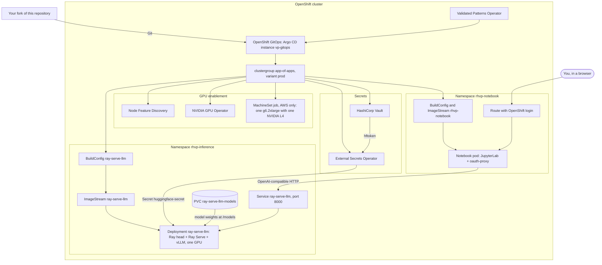

# vLLM + Ray Serve inference server: a Validated Pattern for OpenShift

This [Validated Pattern](https://validatedpatterns.io/) deploys an OpenAI-compatible LLM server on Red Hat OpenShift
through OpenShift GitOps. The server is a single pod that runs Ray Serve LLM with the vLLM engine. The cluster builds
its image from this repository, using stock packages only: PyPI wheels on NVIDIA's CUDA UBI 9 image. The pattern
also deploys the pieces the server needs: Node Feature Discovery and the NVIDIA GPU Operator, and Vault with External
Secrets for an optional Hugging Face token. It adds a small JupyterLab whose notebook times the server.

**Community sandbox pattern by Eugo — not produced, supported or validated by Red Hat.**

> [!WARNING]
> **Cost.** On AWS, the default install creates **one billable GPU instance: `g6.2xlarge` with one NVIDIA L4**.
> AWS bills it for as long as it runs.
>
> - To stop that, set `global.gpuMachineSet: none` in `values-global.yaml` in your fork, and push the change,
>   before you install.
> - Off AWS, nothing is created.
> - Uninstalling does not delete the GPU machine; see [Uninstall](#uninstall).

- [Architecture](#architecture)
- [What is in the stock stack](#what-is-in-the-stock-stack)
- [Prerequisites](#prerequisites)
- [Quick start](#quick-start)
- [What to expect on the first install](#what-to-expect-on-the-first-install)
- [Using the API](#using-the-api)
- [The notebook](#the-notebook)
- [Changing the model](#changing-the-model)
- [Uninstall](#uninstall)
- [Support](#support)
- [License](#license)
- [What this pattern was verified against](#what-this-pattern-was-verified-against)

Contributors and coding agents: read [AGENTS.md](AGENTS.md). It covers the repo layout, every deploy path, the rules
and troubleshooting.

## Architecture



- **The Validated Patterns Operator** installs OpenShift GitOps. It points Argo CD at your fork through the
  clustergroup chart, which creates every app listed in `variants/prod/values-prod.yaml`.
- **The server pod** runs a Ray head, Ray Serve and vLLM. It reports Ready only after the model has loaded.
- **The notebook pod** serves JupyterLab behind the OpenShift oauth-proxy. Only users who may edit the
  `rhvp-notebook` namespace (its editors and admins, and cluster admins) can open it. It talks to the server
  through the in-cluster Service.

## What is in the stock stack

| Component | Version | Source |
|---|---|---|
| Ray (`ray[llm]`, Ray Serve LLM) | 2.60.0 | PyPI |
| vLLM | 0.29.0 (the version Ray 2.60.0 pins) | PyPI |
| PyTorch | 2.13.0, CUDA 13.0 wheels | PyPI |
| FlashInfer | 0.6.18 | PyPI |
| CUDA toolkit (`nvcc`, runtime) | 13.0.3 | the base image, plus the pip `cuda-toolkit` 13.0.3 pin |
| Python | 3.12 | UBI 9 packages |
| Base image | `nvcr.io/nvidia/cuda:13.0.3-devel-ubi9`, pinned by digest | NVIDIA, no login needed |
| Default model | `Qwen/Qwen2.5-0.5B-Instruct` at a pinned revision, served as `qwen2.5-0.5b-instruct` | Hugging Face, not gated |

- **Locks.** Python packages are installed from hash-locked files, one per CPU architecture
  (`inference-server/requirements-x86_64.lock` and `requirements-aarch64.lock`), with wheels only.
- **Everything comes from PyPI.** No package index outside PyPI is used, so FlashInfer compiles its GPU kernels on
  the node when the server starts. The image does not include the patches Ray applies in its own `rayproject/ray-llm`
  images.
- **Telemetry is off.** Ray and vLLM usage statistics and request prompt logging are turned off.
- **Operators:**
  - Red Hat OpenShift GitOps;
  - the Validated Patterns Operator (community);
  - the Red Hat External Secrets Operator;
  - Node Feature Discovery;
  - the NVIDIA GPU Operator (certified).

  HashiCorp Vault comes from the Validated Patterns chart.

The notebook labels its WITHOUT EUGO side "Stock vLLM 0.29.0 · Ray 2.60.0 · PyTorch 2.13.0 from PyPI · Python 3.12 ·
NVIDIA CUDA 13.0.3 UBI 9 image".

GPU support: built for the GPU architectures in vLLM's release build list
([v0.29.0 release pipeline](https://github.com/vllm-project/vllm/blob/v0.29.0/.buildkite/release-pipeline.yaml));
not tested on OpenShift by us. CUDA 13 needs NVIDIA driver version 580 or newer.

## Prerequisites

- OpenShift 4.18 or newer, and cluster-admin access.
- A StorageClass that provisions volumes dynamically, for the model cache.
- The internal image registry set to `Managed`: the cluster builds both images itself. It starts as `Removed` on
  bare metal and vSphere. To check:
  `oc get configs.imageregistry.operator.openshift.io cluster -o jsonpath='{.spec.managementState}'`
- A GPU node. On AWS the pattern creates one (see the cost note above). Elsewhere, add a node with an NVIDIA GPU that
  the NVIDIA GPU Operator supports.
- On your workstation:
  - podman 4.3 or newer;
  - git;
  - `oc`, logged in to the cluster;
  - if `KUBECONFIG` is set, it must point inside your home directory.
- Your own fork of this repository, with your branch pushed. Argo CD deploys from that fork, not from your disk.

## Quick start

1. Fork this repository on GitHub, then clone your fork:
   ```sh
   git clone https://github.com/<you>/rhvp-vllm-ray-inference-server.git
   cd rhvp-vllm-ray-inference-server
   ```
2. Edit `values-global.yaml`:
   - `global.gpuMachineSet`: `create` (one AWS g6.2xlarge) or `none`.
   - `global.model.*`: optional.

   Commit and push:
   ```sh
   git commit -am "Configure my install"
   git push
   ```
3. Optional, needed only for a gated model: create your secrets file and put your Hugging Face token in `hftoken`.
   Keep this file out of git.
   ```sh
   mkdir -p ~/.config/validated-patterns
   cp values-secret.yaml.template \
      ~/.config/validated-patterns/values-secret-rhvp-vllm-ray-inference-server.yaml
   ```
4. Log in and install:
   ```sh
   oc login --token=<token> --server=<api-url>
   ./pattern.sh make install
   ```
5. Watch it come up:
   ```sh
   oc get applications.argoproj.io -A
   oc get builds -n rhvp-inference
   oc get pods -n rhvp-inference -w
   ```

[AGENTS.md](AGENTS.md#how-to-deploy) also covers the web-console install, private forks, reloading secrets, and how
updates and image rebuilds work.

## What to expect on the first install

The first install does a lot of work, in roughly this order:

1. The operators install, and Vault starts.
2. On AWS, the MachineSet job creates the GPU node. The GPU Operator then installs the NVIDIA driver on it.
3. The cluster builds the server image from `inference-server/Containerfile`. This is a large build: it pulls a
   multi-gigabyte CUDA development image and installs several gigabytes of wheels, so the build node needs plenty of
   free ephemeral storage.
4. The server pod stays Pending until a node advertises `nvidia.com/gpu`.
5. On its first start, the server downloads the model into the PVC `ray-serve-llm-models`, where it stays across
   restarts. vLLM and FlashInfer also compile GPU kernels. Those caches are not kept, so every new server pod compiles
   them again.
6. The pod turns Ready only once the model is loaded.

`./pattern.sh make install` waits at most 60 minutes for every Argo CD application to be Synced and Healthy, and
reports a failure if they are not. A first install can outlast that wait. The failure undoes nothing: the pattern is
already installed and its secrets loaded. To recover:

```sh
oc get builds -n rhvp-inference                  # is the image build still running, or did it fail?
oc logs -f bc/ray-serve-llm -n rhvp-inference    # follow the latest build
oc start-build ray-serve-llm -n rhvp-inference --follow   # only if the build failed
oc get pods -n rhvp-inference                    # Pending = no GPU yet; Running but not Ready = still loading
./pattern.sh make argo-healthcheck               # re-check once things settle
```

To skip the wait entirely, install with `VP_SKIP_ARGO_HEALTHCHECK=true ./pattern.sh make install`, then run
`./pattern.sh make argo-healthcheck` later.

## Using the API

The server is reachable inside the cluster at `http://ray-serve-llm.rhvp-inference.svc:8000`. From your workstation,
forward the port:

```sh
oc port-forward svc/ray-serve-llm 8000:8000 -n rhvp-inference
```

In another terminal:

```sh
curl -s http://localhost:8000/v1/models

curl -s http://localhost:8000/v1/chat/completions \
  -H 'Content-Type: application/json' \
  -d '{
        "model": "qwen2.5-0.5b-instruct",
        "messages": [{"role": "user", "content": "Say hello in one sentence."}],
        "max_tokens": 64
      }'
```

The `model` field is `global.model.id`. Any OpenAI-compatible client works with `base_url` set to
`http://localhost:8000/v1`.

**Optional Route.** Set `route.enabled: true` in `charts/all/ray-serve-llm/values.yaml` in your fork and push. The
Route raises the router timeout to 10 minutes. It has no authentication: anyone who can reach the cluster's router
can use the model and the GPU.

## The notebook

Open it through its Route and log in with your OpenShift account. The proxy lets in only users who may update the
Service `rhvp-notebook` in namespace `rhvp-notebook`: that namespace's editors and admins, and cluster admins. Any
other logged-in user gets 403 Forbidden. To let someone in, give them the `edit` role there:
`oc adm policy add-role-to-user edit <user> -n rhvp-notebook`.

```sh
oc get route -n rhvp-notebook
```

The notebook is `stock_vs_eugo_inference.ipynb`. It times the server in four sections:

1. **Server pod start to Ready.** Read from the pod's Kubernetes status, so this section runs only inside the
   cluster.
2. **Time to first token.**
3. **Single-stream decode tokens per second.**
4. **Aggregate tokens per second at 1, 8 and 32 concurrent requests.**

How it measures:

- The prompts are distinct, generated from a fixed seed, and each has the same number of words (so about the same
  number of tokens).
- In sections 2 to 4, a warm-up with different prompts runs before the timed requests.
- Every request uses `temperature=0` and a fixed `max_tokens`.
- Tokens are counted from the server's usage report.

Each section shows a WITHOUT EUGO side: this stock server, measured live in your run.

- **Sections 1 and 2** also show a WITH EUGO side. It reads "No measured result is shown for this comparison."
- **A WITH EUGO result** appears only when it was measured in the same run as WITHOUT EUGO, on the same hardware,
  with the same requests and server settings.
- **Sections 3 and 4** are stock-only.

The pod copies the notebook folder into a scratch directory each time it starts, so your edits are lost when the
pod restarts. Download anything you want to keep. The notebook is generated by `notebooks/make_notebook.py` and is
committed without outputs.

## Changing the model

1. In `values-global.yaml`, set:
   - `global.model.id`: the name clients use;
   - `global.model.source`: the Hugging Face repo id;
   - `global.model.revision`: the new model's Hugging Face commit, or empty for its latest version. Do not keep the
     old model's commit.
2. Push. Argo CD updates the server's ConfigMap, and the server pod restarts and downloads the new model.
3. For a gated model, load your token first ([Quick start](#quick-start), step 3, then
   `./pattern.sh make load-secrets`).

The model has to fit in the GPU's memory alongside the engine settings in the `ray-serve-llm` chart.

## Uninstall

1. Run `./pattern.sh make uninstall`. The Validated Patterns framework marks it experimental; see
   [the uninstall announcement](https://validatedpatterns.io/blog/2026-02-16-pattern-uninstall/). The Validated
   Patterns Operator and OpenShift GitOps stay installed.
2. **Delete the GPU MachineSet yourself, or AWS keeps billing for the instance.** An imperative job created it, not
   Argo CD, so uninstall does not remove it. Do this only after the uninstall, or after `gpuMachineSet: none` has
   synced; otherwise the job may create it again.
   ```sh
   oc get machinesets -n openshift-machine-api \
     -o custom-columns=NAME:.metadata.name,TYPE:.spec.template.spec.providerSpec.value.instanceType
   oc delete machineset <name-of-the-g6.2xlarge-machineset> -n openshift-machine-api
   ```
3. Check `oc get pv` for a leftover volume from the claim `rhvp-inference/ray-serve-llm-models`.

## Support

Support is community best effort, through
[GitHub issues](https://github.com/eugo-inc/rhvp-vllm-ray-inference-server/issues). No response time is promised.
Red Hat does not support this pattern.

## License

This repository is licensed under [Apache-2.0](LICENSE). Server code ported from Eugo is licensed under
BSD-3-Clause, Copyright (c) 2026, Eugo; those files say so in their header (see [LICENSES/](LICENSES/)). Packages
installed at build time keep their own licenses.

## What this pattern was verified against

- **Checked:**
  - The charts were rendered with Helm and schema-checked against the clustergroup chart's values schema.
  - The secrets template was checked against the Validated Patterns secrets schema.
  - The aarch64 server image was built and served locally with docker on one NVIDIA GPU, running as an arbitrary
    UID in group 0: the model loaded, a chat request was answered, and SIGTERM stopped the server cleanly.
- **Not yet checked: an install on a live OpenShift cluster.** That means none of these has run: the GitOps install,
  the in-cluster image builds, the GPU Operator setup, the MachineSet job, and the notebook pod behind oauth-proxy.
- **Not built:** the x86_64 image, which the default AWS GPU node uses. Its lock file exists.
